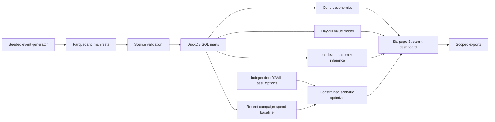

# International Customer Acquisition & Marketing Investment Optimization

A complete local Python, DuckDB and Streamlit platform for synthetic international
acquisition analytics, customer value, randomized welcome offers and budget planning.

**SIMULATED DATA — Independent educational portfolio demonstration. No American
Express data, systems, endorsement or affiliation.** Events are fictional 2024–2025
activity. Optimizer outputs are hypothetical scenarios, not observed impact.

## Quick start

Python **3.11+** is required; verified with Python 3.12.4 on Windows. No API keys,
cloud account, Docker, GPU or database server is needed. Internet is used only for
installing open-source dependencies. Application execution is offline.

PowerShell, from the project directory:

```powershell
python -m venv .venv
.\.venv\Scripts\Activate.ps1
python -m pip install -e '.[dev]'
python -m investopt demo --seed 42
python -m investopt smoke
python -m streamlit run app/Home.py
```

If activation is restricted, use `.venv\Scripts\python` in place of `python`; there
is no need to change the execution policy. macOS/Linux:

```bash
python3 -m venv .venv
source .venv/bin/activate
python -m pip install -e '.[dev]'
python -m investopt demo --seed 42
python -m investopt smoke
python -m streamlit run app/Home.py
```

Open [the dashboard](http://127.0.0.1:8501). Stop it with Ctrl+C. The server binds to
loopback. On mapped/network drives, add `--server.fileWatcherType poll` if source
changes do not reload. Missing data produces setup guidance rather than a traceback.

For a smaller independent pipeline:

```bash
python -m investopt demo --seed 43 --leads 1500 --root scratch/demo43
python -m investopt smoke --root scratch/demo43
```

Set `INVESTOPT_HOME` to that run's absolute directory to display it in Streamlit:
`$env:INVESTOPT_HOME = 'C:\path\to\demo43'` in PowerShell, or
`export INVESTOPT_HOME=/path/to/demo43` in bash.

## Implemented features

| Area | Implementation |
|---|---|
| Synthetic data | Seeded five-market leads, pre-outcome balanced offer assignment, conversions, retained/churned customer activity, campaigns and redemption |
| Data engineering | Six Parquet sources, manifests, parameter/source SHA256, source validation, transactional SQL marts, idempotent rebuilds |
| Acquisition analytics | Funnel, market/channel/month comparisons, behavioral segments, utilization outliers and mature customer activity |
| Accounting | Explicit contribution, paid incentives, acquisition investment, CAC, 180-day cohort ROI and safe undefined ratios |
| Customer value | Actual gradient-boosted models, chronological validation grid, preprocessing within training, training-median baseline, held-out diagnostics and saved pipeline |
| Experiments | All-assigned-lead ITT, zero nonconverters, 95% Welch intervals/p-values, Newcombe conversion intervals, balance and small-sample diagnostics |
| Optimization | Disclosed independent response assumptions, budget equality, editable cell bounds, analytic gradients, feasible recent-spend baseline and sensitivity |
| Dashboard | Six interactive Streamlit pages, real warehouse/artifact results, scoped filters and CSV/XLSX downloads |
| Reporting | Executive Markdown, CSV scorecards, Excel workbook, self-contained offline HTML charts, model metrics and data-quality details |
| Verification | Mathematical, data-integrity, leakage, boundary-date, model, inference, optimization, CLI, reporting and dashboard tests; CI workflow |

## Architecture



```text
investopt/                  Importable analytics package and CLI
  generator.py              Deterministic event simulation
  validation.py             Source contracts, keys, dates and reconciliation
  warehouse.py / sql/       Transactional DuckDB ETL and marts
  kpis.py / economics.py    Whitelisted filters and financial calculations
  ltv.py                    Temporal model training and diagnostics
  experiment.py             Lead-level ITT inference
  optimizer.py              Constrained scenario planning
  reporting.py / demo.py    Reports, orchestration and smoke validation
  defaults/                 Packaged fallback YAML configuration
config/                     Editable scenario and illustrative FX settings
app/Home.py                 Executive overview
app/pages/                  Five additional analytical pages
app/components.py           Shared filters, cache, charts and exports
tests/                      Deterministic unit/integration/UI tests
data/raw/                   Generated Parquet, manifest and assumption snapshot
data/warehouse/             analytics.duckdb
artifacts/                  Model, predictions, metrics and run manifests
reports/                    Actual generated reports, charts and screenshots
docs/                       Methodology, verification and original specifications
.github/workflows/ci.yml    Python 3.11 install, lint, tests and smoke pipeline
```

SQL is packaged under `investopt/sql` to retain scripts when installed. Paths use
`pathlib`; `--root` / `INVESTOPT_HOME` isolate runs. Large generated data, models,
databases and virtual environments are excluded from Git. Original numbered specs
and the initial pack README are preserved in `docs/spec/`.

## Commands

All commands support `--help` and `--root`; failures exit nonzero with guidance.

```bash
python -m investopt generate --seed 42 --leads 30000
python -m investopt validate
python -m investopt build
python -m investopt train --seed 42
python -m investopt experiment --seed 42
python -m investopt optimize --budget 1000000
python -m investopt report
python -m investopt demo --seed 42
python -m investopt smoke
pytest -q
ruff check .
python -m streamlit run app/Home.py --server.headless true
```

`demo` executes all stages, writes a completion manifest and runs smoke. Reruns
replace tables and stable output filenames. Avoid concurrent pipeline writers.
Dashboard reads use short connections. `generate --output custom/raw` exports raw
files elsewhere; downstream stages use `<root>/data/raw`, so prefer `--root` for a
complete independent pipeline. Raw generation permits 100 leads; ML requires at
least 40 mature customers across five acquisition months. Use 1,500+ for full demos.

## Dashboard walkthrough

1. **Executive overview:** filter market/channel/lead-month and inspect acquisitions,
   CAC, 180-day contribution, cohort ROI, utilization and reconciliation.
2. **Markets & acquisition:** explore conversion/CAC/ROI heatmaps, budget execution,
   segment contribution and late-window customer activity.
3. **Customer value:** choose held-out acquisition cohorts, compare model/baseline,
   scatter, forecast deciles, segment errors and validation permutation rankings.
4. **Welcome-offer experiments:** inspect sample sizes, net ITT, conversion lift,
   intervals, p-values, arm economics and exploratory subgroup uncertainty.
5. **Investment optimizer:** edit budget, active markets/channels, value multiplier
   and cell assumptions/bounds. Inspect feasible baseline comparison and sensitivity.
6. **Data quality & methodology:** inspect row counts, required checks, intentional
   missingness, reconciliation, FX, configuration and source provenance.

Downloads reflect each page's scope and synthetic classification. Model downloads
contain selected held-out predictions; experiment downloads contain recomputed
filtered summary effects, intervals and sample sizes.

## Methodology

See [detailed methodology](docs/METHODOLOGY.md) and
[metric glossary](docs/14_METRIC_GLOSSARY.md).

- **Population:** India, UK, Canada, Australia, Singapore; Search, Social, Referral,
  Partnership. Synthetic broad behavior segments; no protected demographic features
  or personal identifiers. Fixed illustrative USD/local FX: INR 0.012, GBP 1.25,
  CAD 0.74, AUD 0.66, SGD 0.75. These are assumptions, not current quotes.
- **Calendar correction:** the specification's March 31, 2025 cutoff cannot permit
  every 30-day conversion plus 270-day model follow-up by December 31. The generator
  derives `min(configured lead end, observation end - 300 days)`: March 6, 2025.
  Acquisitions can extend into early April. SQL still checks maturity dynamically.
- **Financial grain:** spend is attached once per market/channel/lead month after
  event aggregation. Segment allocation uses eligible lead shares. Cohort ROI is
  acquisition attribution, not calendar accounting recognition or causal advertising ROI.
- **Accounting:** contribution = revenue - direct variable costs - servicing;
  acquisition investment = spend + paid welcome incentives; profit = contribution
  - investment; ROI = profit/investment; CAC = investment/acquisitions. Financial
  contribution is acquisition days 0–180 inclusive. Zero denominators display N/A.
- **ML:** acquisition days 0–90 are features; days 91–270 are the target, discounted
  at 10% annually by exact days. Acquisition months split chronologically ~60/20/20.
  Three boosted-tree candidates use validation MAE; final refit uses train+validation.
  Preprocessing is fitted within training, the baseline stays the original training
  median, and test never selects parameters. Negative targets are preserved. Intervals
  use validation absolute residuals and are approximate after refit. The model is a
  short-horizon value proxy and cannot support prospect-time acquisition decisions.
- **RCT:** offers are randomized before conversion within market/channel/month.
  One outcome per eligible lead over lead days 0–180, including zero nonconverters.
  Net ITT subtracts actual payouts once; campaign spend is excluded from arm contrast.
  Unadjusted Welch inference uses balanced assignment; Statsmodels Newcombe intervals
  cross-check conversion lift. Pre-treatment balance and one-arm/small-N warnings
  are shown. Exploratory subgroups have no multiple-comparison adjustment.
- **Retention:** descriptive share of acquired customers with at least one transaction
  on acquisition days 151–180; no unvalidated propensity model is claimed.
- **Optimization:** customers = `a*(1-exp(-spend/scale))`; cell profit = customers
  * (assumed 180-day contribution - expected incentives) - spend. Independent YAML
  assumptions never consume simulator latents or day-90 predictions. SLSQP uses
  analytic gradients, budget equality and bounds, with $0.01 feasibility tolerance.
  Positive net values give a concave objective; adverse negative values can be
  nonconcave, so no global optimum is claimed there. Campaign budget excludes
  additional expected payouts. Sensitivity reoptimizes at 0.8/1.0/1.2 contribution.

## Planning examples

**Base:** run `python -m investopt optimize --budget 1000000` or use all cells and
multiplier 1.0 in the dashboard. Default campaign bounds allow $0–$4M. Baseline
weights use the latest three months of synthetic spend, adjusted to identical bounds.

**Conservative:** select IN and GB with all channels, budget $500,000, contribution
multiplier 0.8, and optionally cap Social cells at $40,000. The dashboard recomputes
feasibility, allocations and sensitivity. All projected returns depend on assumptions.

## Generated outputs and measured example

- `reports/executive_summary.md`, `kpi_scorecard.csv`, `segment_cohorts.csv`.
- `reports/experiment_summary.csv`: overall/market/channel N, effect, CI, p and warnings.
- `reports/optimizer_allocation.csv`, `optimizer_sensitivity.csv`, `optimizer_low/base/high.csv`.
- `reports/model_metrics.json`, `model_calibration.csv`, `model_segment_errors.csv`,
  `model_feature_importance.csv` and self-contained offline HTML charts.
- `reports/analytics_report.xlsx`: reconciled sheets and methodology.
- `artifacts/ltv_model.joblib`, `feature_schema.json`, `holdout_predictions.parquet`,
  `split_membership.json`, `data_quality.json`, `reconciliation.json`, `demo_manifest.json`.

Executed seed 42 produced **30,000 leads, 6,087 customers, 146,486 transactions**.
Held-out MAE was **$79.91**, versus **$104.68** median baseline; model RMSE **$140.87**,
test N=1,226, acquisition cohorts January–April 2025. Net offer ITT was **-$4.87/lead**,
95% CI **[-$6.95, -$2.79]**, despite **+1.72 pp** conversion lift. These are measured
simulator outputs, not real business results. Exact current values are in reports.

## Validation and limitations

Run `pytest -q`, `ruff check .` and `python -m investopt smoke`. Coverage includes
optional corruption fixtures, keys and contribution reconciliation, exact day
boundaries, leakage controls, chronological splits, saved-model prediction reproduction,
lead-level inference, constraints, workbook reconciliation, CLI error handling, all
six dashboard pages and representative interactions. See [verification](docs/VERIFICATION.md)
for executed results. The remote CI workflow is supplied, not claimed as executed.

Real browser screenshots are saved under `reports/screenshots` where available.
`python scripts/capture_dashboard.py` prints manual capture instructions. Dependencies
are version-bounded in `pyproject.toml`; `requirements-lock.txt` records tested versions.
Fixed-seed generation is deterministic; operational timestamps intentionally differ.

No real personal data, live FX, external inference, causal advertising response
estimation, production authentication or regulated credit decisions are included.
Accuracy and effects are simulator-specific. Load only trusted locally generated
joblib artifacts. Initial installation needs package downloads; runtime is offline.

## Verified local checks

The final local suite passed **65 tests**; Ruff and smoke passed, and all six pages
were rendered with automated checks and reviewed in the local browser. See the
[verification record](docs/VERIFICATION.md) for actual logs and limitations.

Real captured views: [overview](reports/screenshots/01_overview.png),
[markets](reports/screenshots/02_markets.png),
[customer value](reports/screenshots/03_customer_value.png),
[offer experiment](reports/screenshots/04_experiments.png),
[optimizer](reports/screenshots/05_optimizer_results.png), and
[data quality](reports/screenshots/06_data_quality.png). Screenshots are generated
local artifacts; they are not automatically recreated by `demo` or committed.

## Free hosted deployment

For Streamlit Community Cloud select this repository, branch `main`, main file
`app/Hosted.py`, and Python 3.12. The hosted entrypoint creates a reproducible
1,500-lead demo on first startup; generated data/models remain ephemeral and local
to that server. The local CLI still defaults to 30,000 leads. No secrets are needed.

