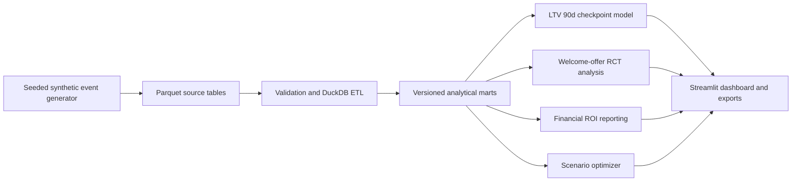

# 01 — Architecture and Repo Layout

## Architecture


## Tech
Python 3.11+, Pandas, NumPy, PyArrow, DuckDB (SQL warehouse), scikit-learn, SciPy, statsmodels (confidence intervals), Plotly, Streamlit, joblib, openpyxl, pytest, ruff. Local Parquet + DuckDB. All versions constrained to compatible ranges in `pyproject.toml` (don't pin obsolete versions). Pure local runtime, no background service.

## Repository generated by Codex
```
.
├── README.md                        # replace pack README with working app documentation; retain pack docs in docs/spec/
├── pyproject.toml
├── .gitignore
├── config/
│   ├── scenario.yaml                # documented synthetic and optimizer assumptions
│   └── markets.yaml                 # illustrative FX assumptions and market config
├── investopt/
│   ├── __init__.py
│   ├── __main__.py                  # argparse or typer entrypoint
│   ├── config.py
│   ├── paths.py
│   ├── generator.py
│   ├── validation.py
│   ├── warehouse.py
│   ├── kpis.py
│   ├── ltv.py
│   ├── experiment.py
│   ├── economics.py
│   ├── optimizer.py
│   ├── reporting.py
│   └── demo.py
├── app/
│   ├── Home.py
│   ├── pages/
│   │   ├── 1_Markets_and_Acquisition.py
│   │   ├── 2_Customer_Value.py
│   │   ├── 3_Welcome_Offer_Experiments.py
│   │   ├── 4_Investment_Optimizer.py
│   │   └── 5_Data_Quality_and_Methodology.py
│   └── components.py
├── sql/
│   ├── 01_dimensional_model.sql
│   ├── 02_acquisition_kpis.sql
│   ├── 03_cohorts.sql
│   └── 04_experiment_metrics.sql
├── tests/
│   ├── conftest.py
│   ├── test_generator.py
│   ├── test_validation.py
│   ├── test_sql_kpis.py
│   ├── test_ltv.py
│   ├── test_experiments.py
│   ├── test_economics.py
│   ├── test_optimizer.py
│   ├── test_reporting.py
│   └── test_pipeline.py
├── scripts/
│   └── capture_dashboard.py         # OPTIONAL only if browser automation is available
├── data/                             # gitignored; generated
│   ├── raw/
│   └── warehouse/
├── artifacts/                        # gitignored; generated models/evaluation
├── reports/                          # sample outputs, gitignored where appropriate
└── docs/                             # methodology, assumptions, original specification
```

Names can vary if documented and internal contracts/tested commands remain consistent. Keep functions modular and public operations importable for testing. Use `Path` not machine-dependent absolute paths.

## Architectural principles
- Pure analysis functions when possible; do not mix financial formulas with Streamlit callbacks.
- SQL computes marts and KPI aggregations; Python computes model training, inference, RCT inference and constrained optimization.
- Data contract and schema validation are explicit. Job reruns overwrite reproducible build artifacts intentionally, not duplicate records.
- State-free dashboard queries load cached derived data and present graceful instructions if demo was not built.
- Central configuration for seed, simulated exchange rates, budgets, horizons and cost definitions.
